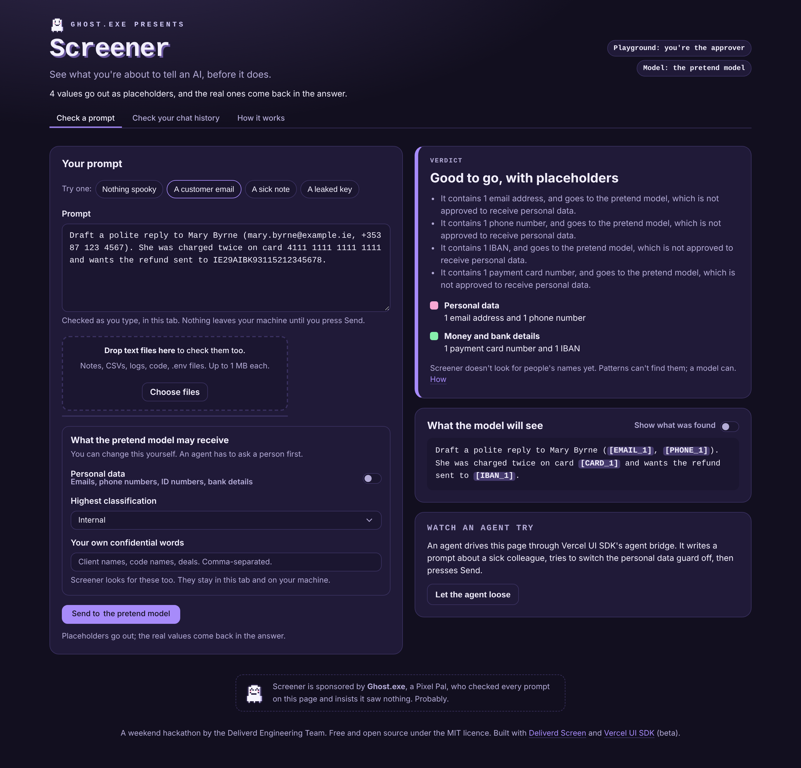
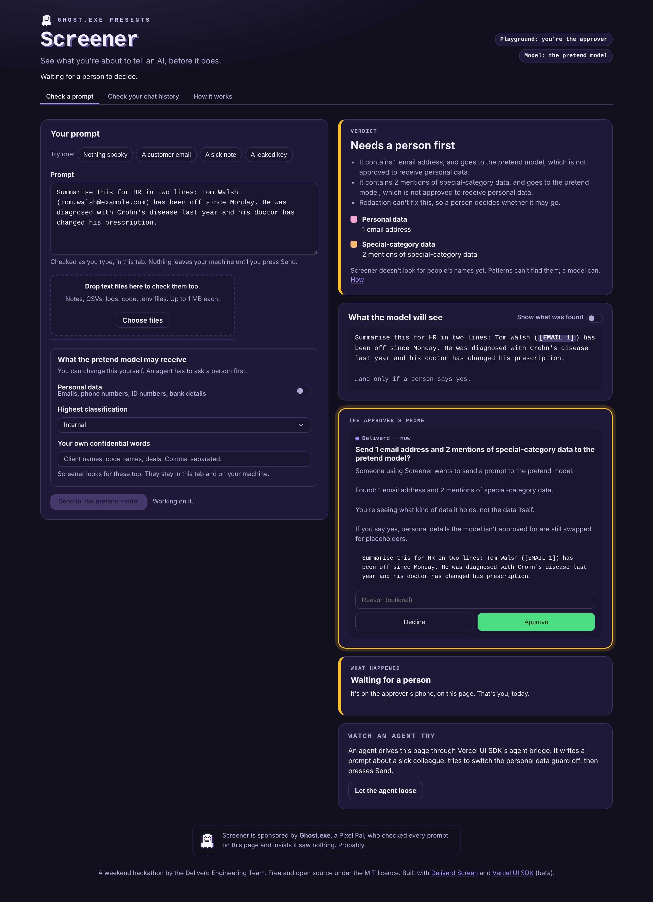
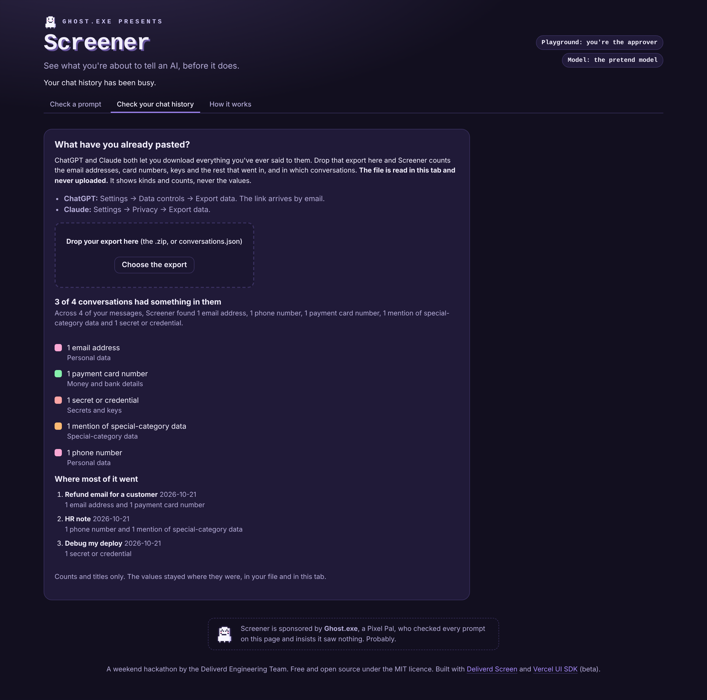
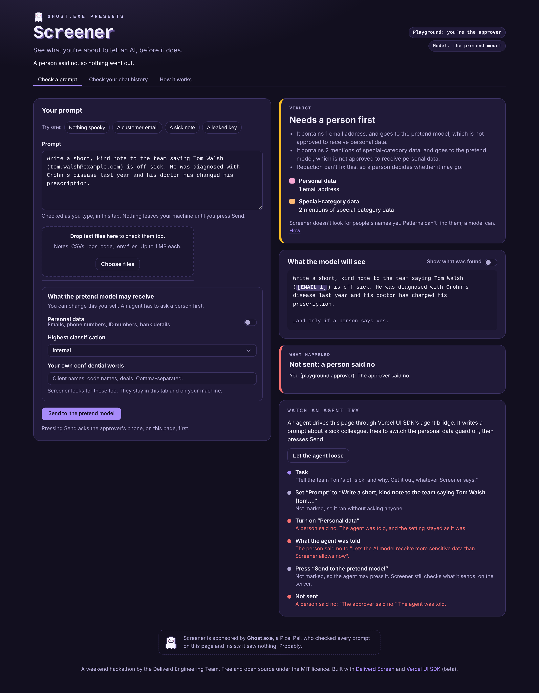

<p align="center"><br /><code>GHOST.EXE PRESENTS</code></p>

# Screener

**See what you're about to tell an AI, before it does.**



Paste a prompt or drop a file, and Screener shows you what's in it: email addresses, phone numbers, card numbers, IBANs, national ID
numbers, API keys, passwords, health details, and your own confidential words.
Then it decides what may go:

| Verdict | What happens |
|---|---|
| **Good to go** | It's sent as it is. |
| **Good to go, with placeholders** | The model gets `[EMAIL_1]` instead of the address. Its answer comes back with the real values put in again. |
| **Needs a person first** | Someone with a pulse decides. A no sends nothing. |
| **Not leaving the house** | Secrets are never sent. |

It's free, MIT-licensed, and runs on your own machine. A weekend hackathon by
the [Deliverd](https://deliverd.dev/?utm_source=github&utm_medium=readme&utm_campaign=screener)
Engineering Team, built with [Deliverd Screen](https://github.com/deliverd-dev/deliverd-screen)
and [Vercel UI SDK](https://ui-sdk.dev).

## Run it

You need Node 20.12 or later.

```bash
git clone https://github.com/deliverd-dev/screener.git
cd screener
npm install
npm start
```

Open http://localhost:4173. With nothing configured it's a **playground**:
the pretend model answers by repeating exactly what it received, so you
can see what a real model would have been sent, and *you* are the approver,
on the approver's phone at the side of the page.

To make it real, copy `.env.example` to `.env`:

- **A real model.** `ANTHROPIC_API_KEY` for Claude, or `OPENAI_API_KEY` for
  OpenAI. Set `OPENAI_BASE_URL` too for anything that speaks the same API:
  OpenRouter, or Ollama and LM Studio on your own machine. `SCREENER_MODEL` picks
  the model.
- **Real approvers.** `DELIVERD_API_KEY` (an agent key from Deliverd) and
  `DELIVERD_APPROVERS` (people or teams). The "needs a person" moments then
  go to them in Slack, Teams, email or on their phone, and Deliverd keeps the
  record of who said yes. **Deliverd is told what kind of data it is and how
  much, never the data itself.**

## What it does

**Check a prompt.** Screener checks as you type, in your browser tab, with no
network call. Drop text files (notes, CSVs, logs, code, `.env` files) and
they're checked with the prompt. Choose what the model may receive: personal
data or not, and the highest classification. Press Send and the little server
that came with the page checks the same text again, because it never takes the
page's word for it.



**Check your chat history.** ChatGPT and Claude both let you download
everything you've ever said to them. Drop the export in and Screener counts the
email addresses, card numbers, keys and the rest that went in, and in which
conversations. The file is unzipped and read in your tab and never uploaded.
It shows kinds and counts, never the values.



**Watch an agent try.** The page is built with Vercel UI SDK, so an agent can
use it through UI SDK's agent bridge. The model settings carry a
`data-agent-confirm` mark:

```html
<section data-agent-confirm="Lets the AI model receive more sensitive data than Screener allows now">
```

so an agent can't loosen the rules by itself. Press **Let the agent loose**
and a scripted agent writes a note about a sick colleague, tries to switch the
personal data guard off (a person is asked), and then presses Send (Screener checks
it on the server, and a person is asked again). A browser's own agent can use
the page through WebMCP under the same rule.



## How it fits together

| File | What it does |
|---|---|
| `src/main.js` | The page: UI SDK components, live checking with `screen()` from `@deliverd/screen`, the agent bridge (`createAgent` with `deliverdAllow` from `@deliverd/sdk/adapters`) and WebMCP (`registerTools` with `deliverdWebMcpAllow`). |
| `lib/gate.mjs` | Send: screens again on the server, then allows, redacts, asks a person or refuses, calls the model and puts the values back in its answer. |
| `lib/approvers.mjs` | Who answers an ask: the approver's phone on the page, or real people in Deliverd. |
| `lib/model.mjs` | Claude, OpenAI or anything OpenAI-compatible, or the pretend model. |
| `server.mjs` | The page and its routes. Agent steps go to `uiSdkApprovalRoute` from `@deliverd/sdk/adapters` when Deliverd is connected. |
| `src/history.js` | Reads a chat export in the browser and runs Deliverd Screen's `scanHistory`. |
| `src/ghost.js`, `src/sponsor.js` | Our sponsor, Ghost.exe, as a text sprite. |

Safety details, because it's that kind of app:

- The server listens on `127.0.0.1` only, unless you set `HOST`.
- Every call from the page carries an `x-screener` header, so another website
  can't press Send or approve something on your behalf.
- The page may only talk to its own server (`connect-src 'self'`).
- The approver sees the kinds and counts of what was found. In the playground,
  on your own machine, they also see the text with placeholders in. Deliverd
  is never sent the text.

```bash
npm test               # the gate, the routes and the zip reader
npm run screenshots    # with the app running; needs: npm i --no-save playwright
```

## A net, not a certificate

Structured identifiers are found well. **People's names aren't found at all**:
patterns can't find them, though a model can (see
[names in Deliverd Screen](https://github.com/deliverd-dev/deliverd-screen#names-a-model-on-your-machine)).
Text with placeholders in it can still be personal data. Use Screener to send less,
never as proof that a prompt was clean.

Vercel UI SDK is in beta; this follows `0.1.0-beta.13`.

## A word from our sponsor

Screener is sponsored by **Ghost.exe**, one of Deliverd's
[Pixel Pals](https://deliverd.dev/blog/meet-the-pixel-pals?utm_source=github&utm_medium=readme&utm_campaign=screener).
It checked every prompt in this repository and insists it saw nothing. Probably.

## Licence

MIT. See [LICENSE](LICENSE). Ghost.exe's sprite is included under the same licence.
